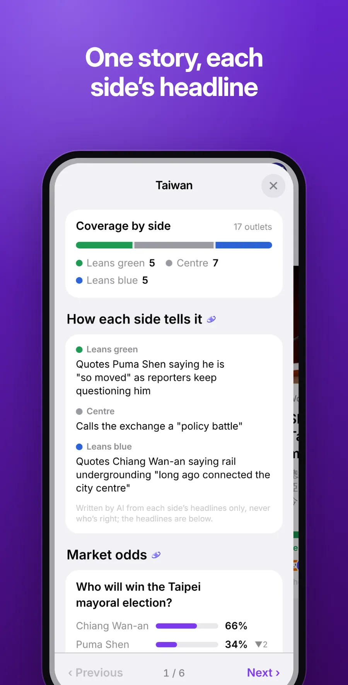
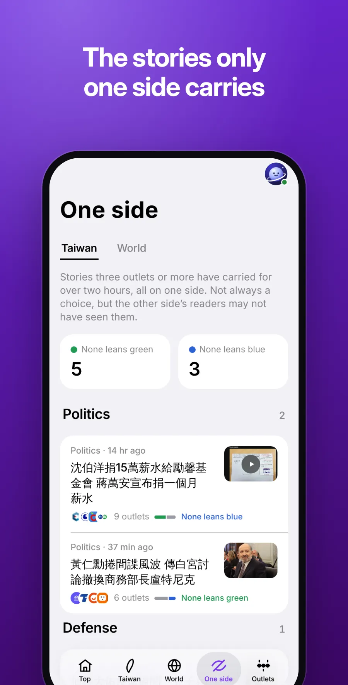
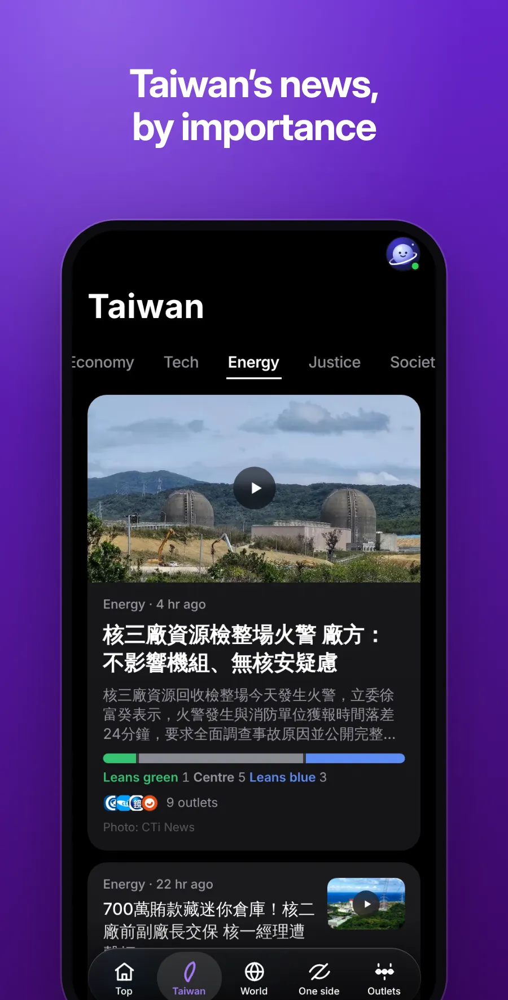
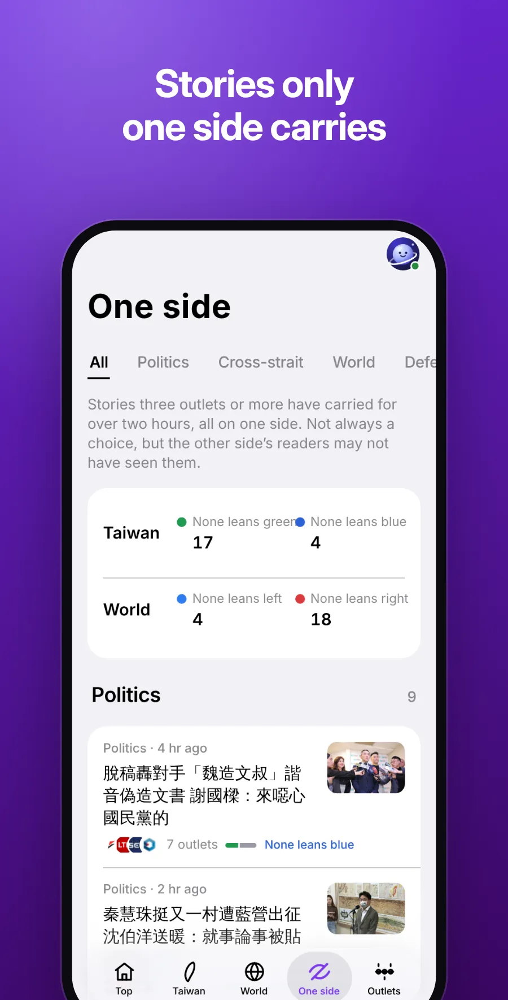
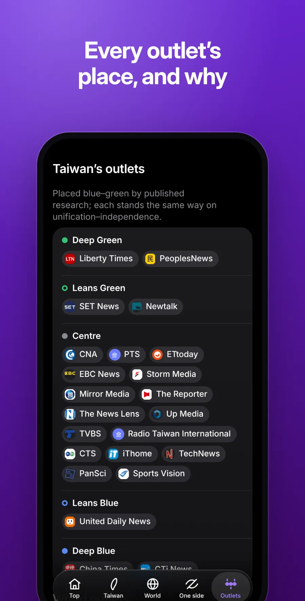
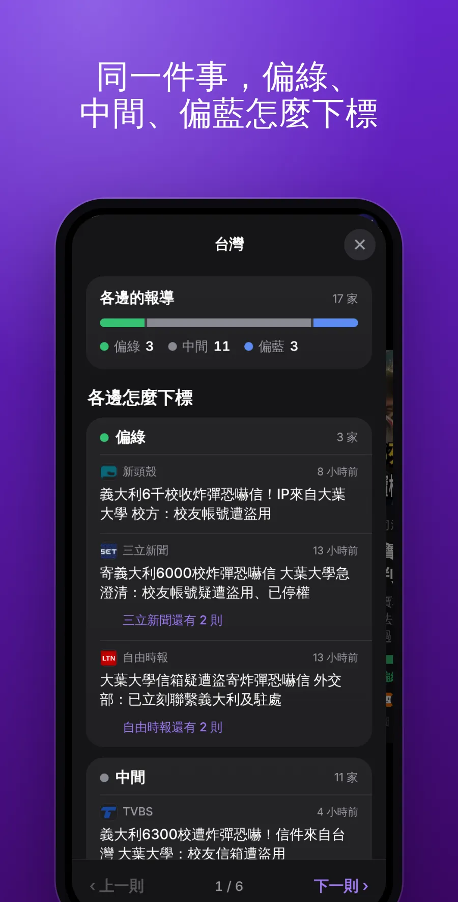
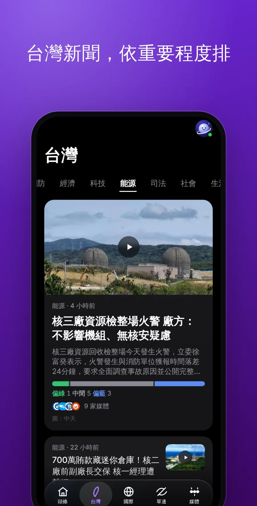

  

<h1 align="center">Orbit News</h1>

  <b>One story, every side.</b> 
  <a href="https://orbit.jaypengx.com/news/"><b>orbit.jaypengx.com/news</b></a>

     

Taiwan's and the world's news (politics, cross-strait, defence, the economy, tech, energy, justice, society, and life, health, science, culture and sport), the same event from every outlet gathered into one story: how many outlets lean green, centre or blue (left, centre or right for English news) carry it, which side left it out, and every headline side by side. The most important stories lead and stay for weeks, growing as coverage comes; swipe through the lead stories, from topic to topic and from story to story; the outlets' own clips play in the app. A tap opens the outlet's own page. Part of **Orbit**, a family of apps for life in Taiwan that share one sign-in, the Orbit Pass. See them all at [orbit.jaypengx.com](https://orbit.jaypengx.com/pass/).

  
  
  

  
  
  

中文畫面

  
  
  

  
  
  

**Beyond the headlines.** 各方怎麼說: on big political and world stories, each side's angle in a line and the one difference that matters, written by AI from their own headlines only, never who's right. 今天五則: five stories past the headlines, picked for you each morning. 你關心的: stories about what you hold in Orbit Securities and follow in Orbit Sports lead, marked 持股 or 追蹤 (read on the phone, nothing sent). 看法案: the laws a Taiwan story names open in Orbit Law; on world stories, the words you're learning in Orbit Words are underlined (新聞學單字).

**Where the places come from.** Taiwanese outlets by published research (Chiang & Shih 2013, TEDS; Chang & Fang 2023; Kao, APSR), newer web outlets by owner and stated stance (marked weaker). English outlets by AllSides Media Bias Ratings™ (CC BY-NC 4.0), and by Media Bias/Fact Check where AllSides has none; only China's state media stand apart. Each outlet's sheet in the app says why.

**Fair use.** Only headlines, links, the outlet's own short summary and picture, each credited; an outlet's YouTube clip plays in YouTube's own player; every tap opens the outlet's site.

How it's built: [MAP.md](MAP.md). Every feature: [FEATURES.md](FEATURES.md).
